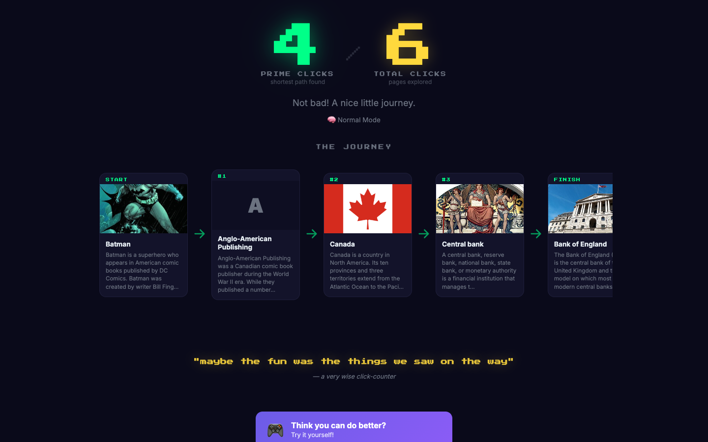

# how many clicks?

the wikipedia connection game. pick two articles, watch a bot click through links to connect them, then try to beat it yourself. saw the wikipedia game on tiktok and wanted a machine to go first.



## how it works

- the bot is a beam search, not an llm. it pulls each page's links from the wikipedia api and scores them on word overlap with the target, a list of related terms (england -> british, london), and a bonus for hub pages like countries that bridge topics.
- it penalizes links that keep it in the same topic cluster so it doesn't loop around one corner of wikipedia.
- normal mode keeps the top 8 links per step and explores up to 100 pages. god mode keeps 20 and explores up to 200. if it runs out, it tells you the two articles live too far apart.
- you get two numbers: prime clicks (length of the path it found) and total clicks (every page it opened, backtracking included), plus a card for each article on the path.
- then you can play the same pair by clicking links yourself.
- everything runs in the browser against the public mediawiki api. no backend, no keys.

## run it

```bash
npm ci
npm run dev
```

open http://localhost:5173. `npm run build` puts a static site in `dist/`.

## built with

react 18, vite, plain css, wikipedia mediawiki api
